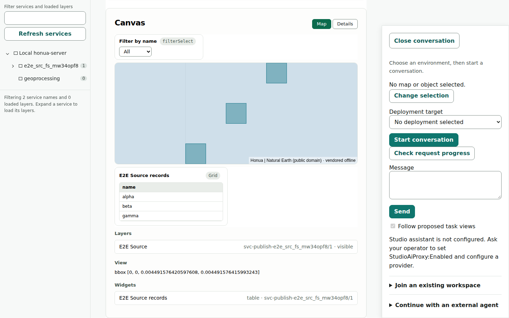
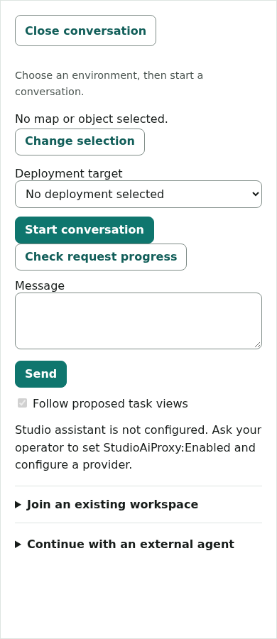

# Conversation drawer evidence

Source: `317065bab110a5c12663dab2fb541904461266ae`. This gallery and its inputs do not change the application source.

The captures use the CI Studio customer Compose profile, governed OIDC sign-in, a real PostGIS publication and canonical Studio drafts. The existing recipe UI adds the actual published layer, and its rendered features are checked before capture. A separate manual New map action also opens a canonical draft on its first attempt. The local assistant has no configured model provider; the drawer shows that unsupported state honestly, and no model prompt is sent.

The [inputs](../images/console-phase-one-drawer/inputs.json) record the published source, local Console image, immutable Server image, Node version, lockfiles and Compose profile. Studio source, release and bundle pin are unchanged. Home retains its current setup layout; connected Home follows in the next increment.

## Open and closed states

| State | Desktop, 1440px | Mobile, 390px |
| --- | --- | --- |
| Home, closed by default | [Screenshot](../images/console-phase-one-drawer/home-closed-1440.png) | [Screenshot](../images/console-phase-one-drawer/home-closed-390.png) |
| Home, explicitly opened | [Screenshot](../images/console-phase-one-drawer/home-open-1440.png) | [Screenshot](../images/console-phase-one-drawer/home-open-390.png) |
| Studio, open | [Screenshot](../images/console-phase-one-drawer/studio-open-1440.png) | [Screenshot](../images/console-phase-one-drawer/studio-open-390.png) |
| Studio, explicitly closed | [Screenshot](../images/console-phase-one-drawer/studio-closed-1440.png) | [Screenshot](../images/console-phase-one-drawer/studio-closed-390.png) |
| Data, closed after leaving Studio | [Screenshot](../images/console-phase-one-drawer/data-closed-1440.png) | [Screenshot](../images/console-phase-one-drawer/data-closed-390.png) |
| Data, explicitly reopened | [Screenshot](../images/console-phase-one-drawer/data-open-1440.png) | [Screenshot](../images/console-phase-one-drawer/data-open-390.png) |
| Populated canvas, closed drawer | [Screenshot](../images/console-phase-one-drawer/studio-canvas-closed-1440.png) | [Screenshot](../images/console-phase-one-drawer/studio-canvas-closed-390.png) |

The desktop drawer remains beside the editor. On mobile the modal covers the background; closing it restores the editor and focus.

## Validation

- Full format verification, Shell suite: 1,421 passed with 3 existing opt-in live skips; integration suite: 1,281 passed with 39 existing opt-in live skips. C# source is unchanged after the recorded suite commit.
- Node: 509 passed with no skips. Documentation and public-content checks passed.
- Published browser smoke: 162 passed, including actual Blazor host retention, query navigation, strict zero-console-error boot, and the unchanged exact one-renewal polling assertion.
- Accessibility/reflow: 12 passed. Operator credential boundaries: 28 passed in full and witness modes with unchanged assertions.
- Governed sign-in and real PostGIS publish/catalog/metadata/query: 2 passed.
- All 15 inspected frames retain one H1, fit the viewport and have no serious or critical WCAG findings. [Aggregated observations](../images/console-phase-one-drawer/observations.json) and the [manual draft result](../images/console-phase-one-drawer/manual-new-map.json) are retained; detailed axe output remains in the lane evidence.

The controller regressions cover manual close for a continuous Studio visit, direct entry, hydration, query/fragment changes, mobile focus/inert/Escape/return, resize, interaction with the service-tree modal, forced colors, unchanged host identity, messages, unsent text, pending replies and file selections. Preference regressions cover operator/environment partitioning, release/source invalidation, expiry, blocked storage, pending/failed validation, same-URL authority changes and stale responses. Existing task, approval, execution and persistence assertions remain intact.

The candidate-image Studio customer journey remains a merge gate alongside exact-head cross-family review and required checks. Local populated captures do not replace that journey.
