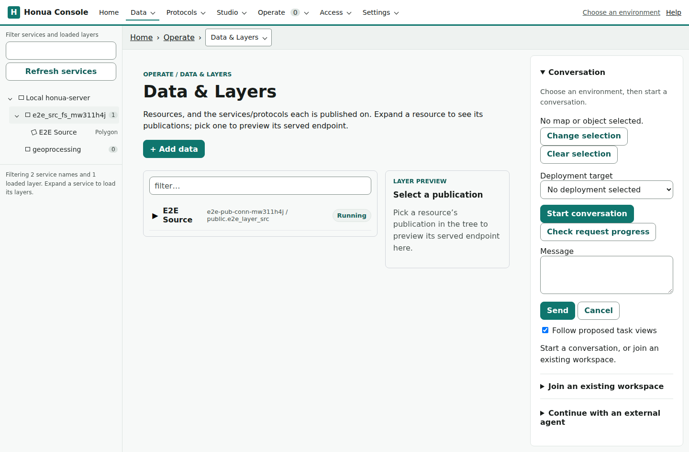
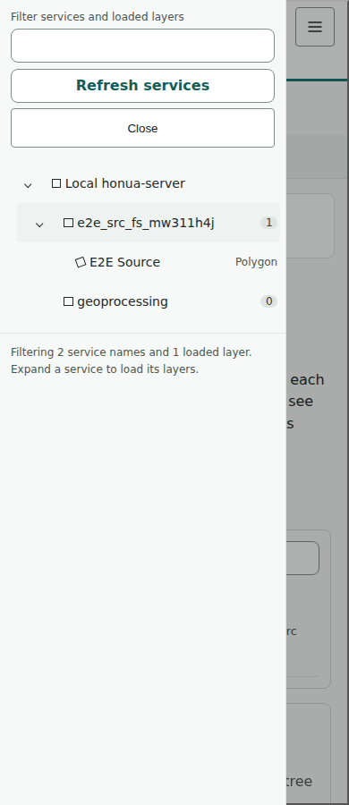

# Service and layer navigation evidence

Source: `9d00702f10ffcb5a950d40f0a8ada864ed4ef2d0`. Later commits change test formatting and this gallery only; the shipping source is unchanged.

The populated captures use the governed OIDC Compose testbed and a real PostGIS publication, not fixture services. The server image, Node version and unchanged lockfile hashes are recorded in [inputs.json](../images/console-phase-one-tree/inputs.json). Studio's pinned bundle is unchanged. Folder behavior is fixture-backed because the server projection is pending; the live server correctly remains flat.

## Expanded tree and selected layer

| State | Desktop, 1440px | Mobile, 390px |
| --- | --- | --- |
| Expanded service | [Screenshot](../images/console-phase-one-tree/expanded-1440.png) | [Screenshot](../images/console-phase-one-tree/expanded-390.png) |
| Canonical layer selected | [Screenshot](../images/console-phase-one-tree/selected-1440.png) | [Screenshot](../images/console-phase-one-tree/selected-390.png) |

## Bound routes

Home retains its current first-run setup, and the fresh membership roster is honestly empty. Studio shows the initial canonical editor; the separate customer journey exercises painted features, save/reopen, publishing and approval on the PR image. The conversation lifecycle and connected Home follow in separate increments.

| Route | Desktop | Mobile |
| --- | --- | --- |
| Home | [Screenshot](../images/console-phase-one-tree/routes/home-1440.png) | [Screenshot](../images/console-phase-one-tree/routes/home-390.png) |
| Data & Layers | [Screenshot](../images/console-phase-one-tree/routes/data-1440.png) | [Screenshot](../images/console-phase-one-tree/routes/data-390.png) |
| Service settings | [Screenshot](../images/console-phase-one-tree/routes/service-settings-1440.png) | [Screenshot](../images/console-phase-one-tree/routes/service-settings-390.png) |
| Health | [Screenshot](../images/console-phase-one-tree/routes/health-1440.png) | [Screenshot](../images/console-phase-one-tree/routes/health-390.png) |
| Observability | [Screenshot](../images/console-phase-one-tree/routes/observability-1440.png) | [Screenshot](../images/console-phase-one-tree/routes/observability-390.png) |
| Members | [Screenshot](../images/console-phase-one-tree/routes/members-1440.png) | [Screenshot](../images/console-phase-one-tree/routes/members-390.png) |
| Settings | [Screenshot](../images/console-phase-one-tree/routes/settings-1440.png) | [Screenshot](../images/console-phase-one-tree/routes/settings-390.png) |
| Studio | [Screenshot](../images/console-phase-one-tree/routes/studio-1440.png) | [Screenshot](../images/console-phase-one-tree/routes/studio-390.png) |

## Unbound and unsupported states

| State | Desktop | Mobile |
| --- | --- | --- |
| First-run setup | [Screenshot](../images/console-phase-one-tree/states/first-run-1440.png) | [Screenshot](../images/console-phase-one-tree/states/first-run-390.png) |
| Unsupported catalog | [Screenshot](../images/console-phase-one-tree/states/unsupported-catalog-1440.png) | [Screenshot](../images/console-phase-one-tree/states/unsupported-catalog-390.png) |

## Validation

- Full Shell suite: 1,421 passed; 3 existing opt-in live skips.
- Full integration suite: 1,281 passed; 39 existing opt-in live skips.
- Node suite: 499 passed; documentation and public-content checks passed.
- Published browser smoke: 144 passed; accessibility/reflow: 12 passed.
- Operator credential boundaries: 28 passed with unchanged assertions in full and witness modes.
- Real governed sign-in and PostGIS publish/catalog/metadata/query: 2 passed.
- All 24 inspected screenshots fit their viewports. Tree, route and state observations retain one H1 and no serious/critical WCAG findings; selected-tree scans also pass.
- Tree text contrast is at least 6.84:1 across normal, hover and selected states; the keyboard focus ring is 3.33:1 at desktop and mobile widths.

The browser controller regressions include empty-parent expansion, roving focus, lazy entry, paging, replacement, selected-row tab entry, contained scrolling and modal inert/focus/resize behavior. Component tests cover 500-service startup, filtered navigation, same-page profile/server/account changes, delayed replies and fresh connection keys. Canonical connection-key tests include distinct legacy name/host fallbacks.

The PR-image Studio customer journey remains a merge gate, alongside exact-head cross-family review and required CI checks.

Aggregated observations are recorded for the [tree](../images/console-phase-one-tree/observations.json), [routes](../images/console-phase-one-tree/routes/observations.json) and [states](../images/console-phase-one-tree/states/observations.json). Detailed axe output is retained in the lane evidence. The browser fixture separately exercises keyboard, paging, lazy focus and modal behavior; it is not presented as populated-server evidence.
